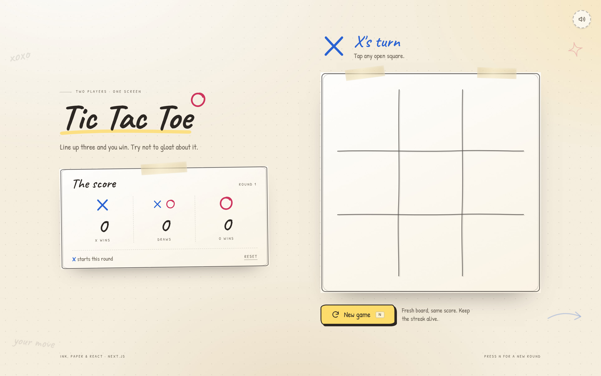
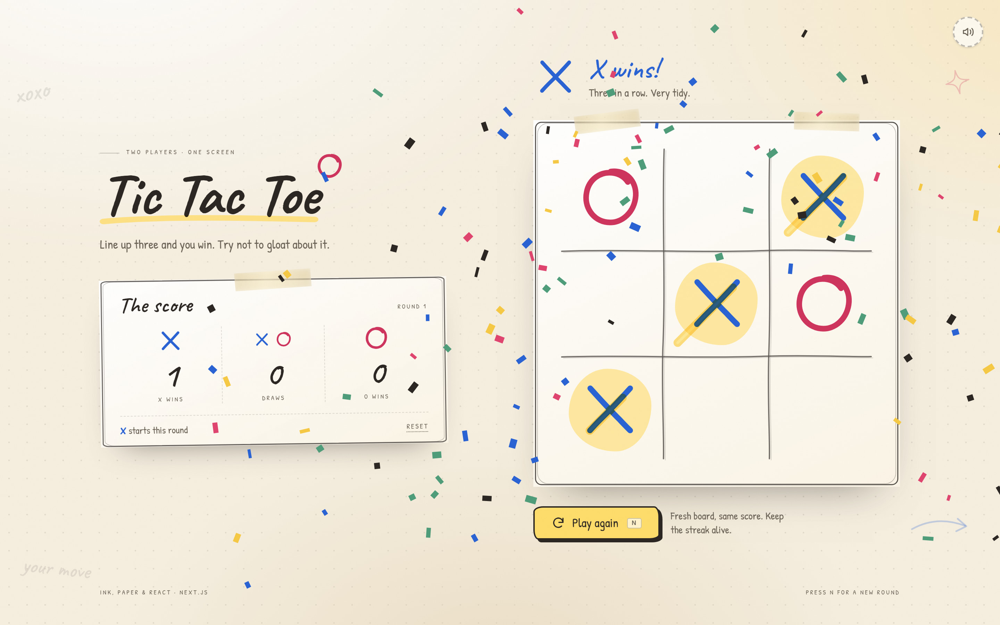
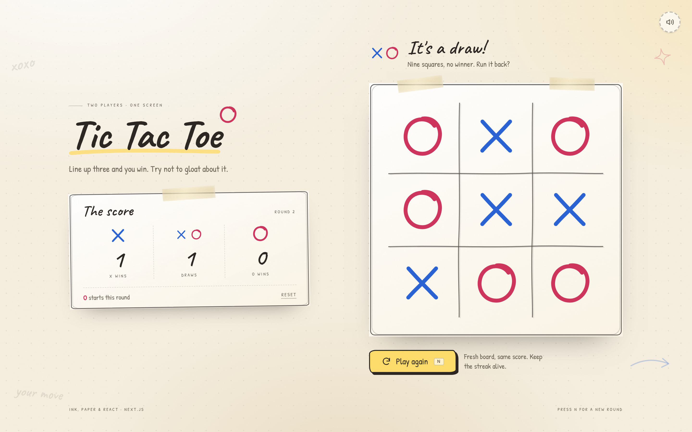
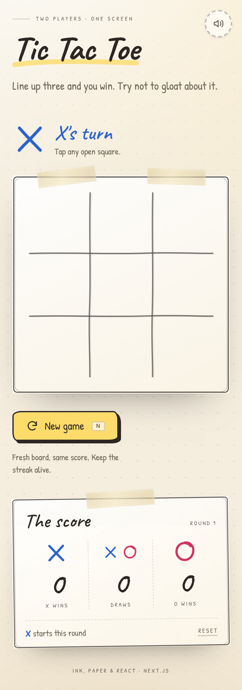

# Tic Tac Toe — Ink & Paper

A two-player tic-tac-toe game with a hand-drawn ink-and-paper look. Built with
**Next.js 16 (App Router)**, **React 19**, **TypeScript**, and **Tailwind CSS 4**.

## Play

Players take turns tapping squares on a 3×3 board. The first player to line up
three marks wins the round; a full board with no line is a draw. The scoreboard
keeps track of X wins, O wins, and draws, and the starting player alternates
each round.

### Features

- Classic X / O rules with win, draw, and turn states
- Hand-drawn SVG marks that animate as they are placed
- Highlighter swipe across the winning line, plus paper confetti
- Scoreboard with wins and draws, persisted in `localStorage`
- Alternating starting player between rounds
- Generated sound effects (Web Audio API) with a mute toggle
- **New game** button, plus the `N` keyboard shortcut
- Responsive layout for desktop and phone
- Accessible buttons, live turn/result announcements, visible focus styles,
  and reduced-motion support

## Screenshots









## Run locally

```bash
npm install
npm run dev
```

Open [http://localhost:3000](http://localhost:3000).

### Scripts

| Command         | Description                |
| --------------- | -------------------------- |
| `npm run dev`   | Start the development server |
| `npm run build` | Create a production build  |
| `npm start`     | Run the production server  |
| `npm run lint`  | Run ESLint                 |

## Deploy to Vercel

```bash
npx vercel          # log in and link the project (preview deployment)
npx vercel --prod   # public production deployment
```

Or push the repository to GitHub and import it at
[vercel.com/new](https://vercel.com/new). No environment variables are needed.

## Project structure

```text
src/
  app/
    globals.css     Theme, paper texture, animations
    icon.svg        Favicon
    layout.tsx      Fonts, metadata, root layout
    page.tsx        Renders the game
  components/
    board.tsx       Board grid, cells, winning-line overlay
    confetti.tsx    Canvas paper confetti
    game.tsx        Game state, scoring, sound, layout
    marks.tsx       Hand-drawn X / O SVG marks
    scorecard.tsx   Scoreboard card
    sketch.tsx      Sketch frame, tape, title underline, margin doodles
  lib/
    game.ts         Board types, win detection, pure helpers
    sfx.ts          Web Audio sound kit
```

## How it works

Game rules live in `src/lib/game.ts` as pure functions (`getOutcome`,
`createBoard`, `otherPlayer`), which keeps the React component focused on
interaction and presentation. The board is a 3×3 grid of buttons; the grid
lines and marks are SVG so they can use the same sketchy stroke style and draw-
in animation. Scores, the round number, the starting player, and the sound
preference are saved to `localStorage` and hydrated after mount to keep server
and client markup in sync.

---

Made for two players sharing one screen.
